# PlatihGym
普拉提健身房预约系统 
亮点：AI健身助手、AI饮食智能分析、WebSocket实时沟通、ECharts数据分析、课程预约与课时联动、会员等级与余额支付、健康记录与教练指导； 
角色：学员、教练、管理员；

所有源码均本人开发，项目是前后端分离的，所有的项目都具备了完整的业务逻辑，不仅仅局限于基础的增删改查（CRUD）操作，系统亮点众多。

本文注重于计算机毕业设计选题指导，列出题目均有源码， 大家可以去【公众号】(毕业终点站)获取或者加我【qq】(2112698948)提意见(别忘记Star哟)。备注：git

声明：仅用于学习使用，请勿用于任何商业行为！

1.系统非商用，非开源，非无偿。

2.由本人开发，如需源码，请联系以下方式，qq:2112698948。

3.项目有很多，并未全部上传，如果未找到想要的，可直接咨询。

# 普拉提健身房预约系统

> 学员在网页端看课、约课、买课时包，用账户余额付款，上课后记体重和饮食，还能跟教练私聊、问 AI；教练在工作台看自己的排课和学员，翻学员的动作记录逐条回指导；管理员管课程、教练、订单，看营收和预约数据。买了几节课、用掉几节、还剩几节，三个端看到的是同一套数。

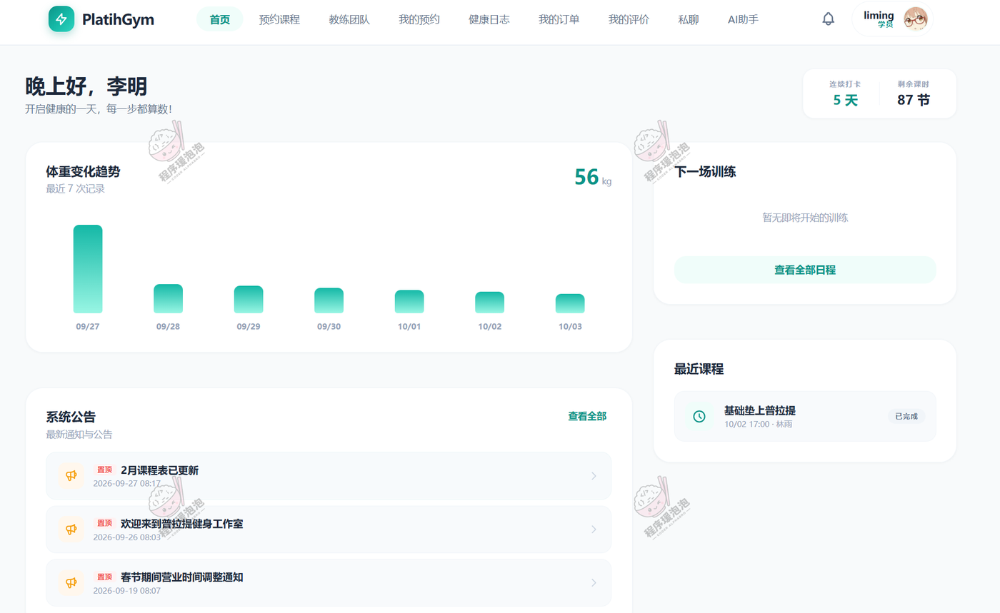

学员登录后先看到自己的状态——连续打卡 5 天、剩余课时 87 节，中间是最近 7 次体重记录的趋势图，右侧是下一场训练和最近课程。

---

## 一、系统亮点

1. **AI 健身助手**：接入 DeepSeek，围绕普拉提训练、饮食营养和体重管理答疑，支持流式回复，会话按主题分条保存，可以随时开新对话。
2. **WebSocket 实时沟通**：学员和教练一对一私聊，课后动作细节、呼吸节奏这类问题不用等到下次上课再问。
3. **ECharts 数据分析**：管理端有营收、订单、预约、课程热度与教练评价等多维统计，教练端也有自己的预约趋势与评分分布。
4. **AI 饮食智能分析**：输入一段饮食描述，自动拆出食物、热量与三大营养素，确认后存成饮食记录，不用手动一项项填。
5. **课程预约与课时联动**：购买课时包、剩余课时、排课预约三者打通——预约时按次扣课时，取消则归还，订单上直接显示「总 8 节 / 剩余 7 节」。
6. **会员等级与余额支付**：会员等级带动购课折扣，账户充值后用余额付款，消费、退款和充值各记一条流水，每条都留变动前后余额。
7. **健康记录与教练指导**：训练动作、组数、时长、完成度、饮食与体重都归到学员名下，教练按学员翻记录，逐条回指导。
8. **多角色协同管理**：管理员、教练、学员三类入口，后台维护、教练排课带课、学员自助购课预约各自分工。
9. **完整健身服务全流程**：从课程维护、教练排课、学员购课、预约签到，到课后评价与健康记录，课程服务和训练跟进是一条线。

## 二、技术选型

| 层次 | 技术 |
| --- | --- |
| 后端 | Java、Spring Boot 3、Spring MVC、MyBatis-Plus、MySQL、JWT、WebSocket |
| 前端 | Vue 3、Vite、Element Plus、Vue Router、Pinia、Axios、ECharts |
| AI 能力 | LangChain4j、DeepSeek 大模型、流式对话、饮食文本分析 |
| 架构 | B/S、MVC、前后端分离、学员网页端 + 管理员后台 + 教练后台、多角色权限 |

## 三、角色与功能

| 角色 | 主要功能 |
| --- | --- |
| 学员（网页端） | 首页概览、预约课程、课程详情、教练团队与私聊、我的预约与取消、健康日志（动作分析 / 饮食 / 体重）、我的订单与退款、我的评价、AI 健身助手、AI 记录饮食、个人中心与充值 |
| 教练（后台） | 个人资料维护、我的课程安排、我的学员、学员消息、教练数据分析、我的评价、课程预约记录、饮食 / 体重 / 动作分析记录与指导回复 |
| 管理员（后台） | 数据总览、学员管理、教练管理、课程类型、课程管理、课程安排、课程教练、教练数据分析、课程订单、课程评价、预约订单分析、会员等级、资金流水、系统公告 |

## 四、系统截图

> 下面按角色分区展示核心页面。截图是节选，需要了解更多页面可以联系我。

### 4.1 学员端

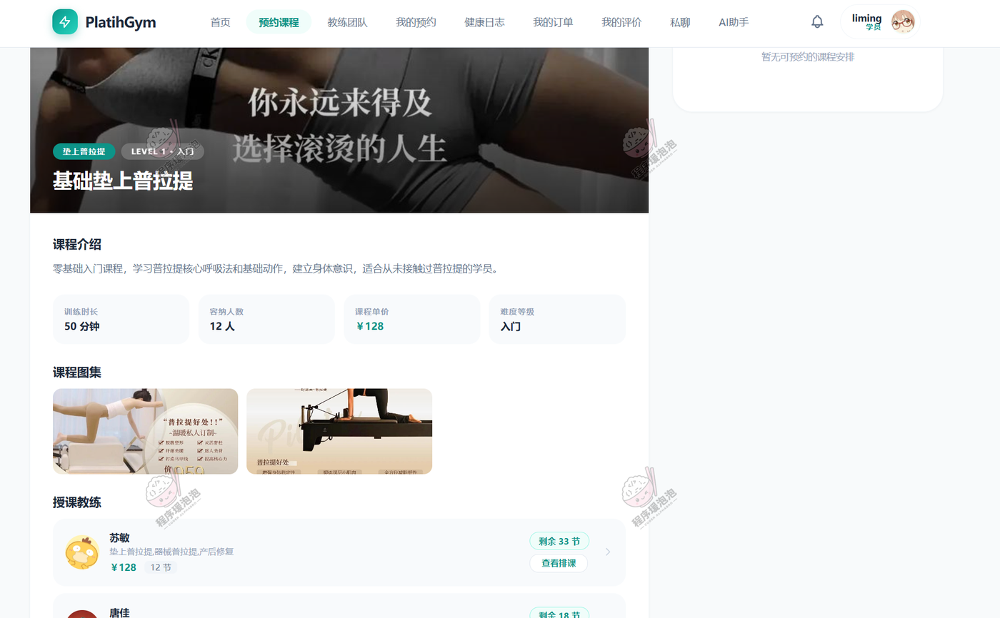

**课程详情**：基础垫上普拉提（LEVEL 1 · 入门），四个参数块直接列出训练时长 50 分钟、容纳人数 12 人、课程单价 ¥128、难度等级；下方是课程图集和授课教练列表。教练卡上能看到擅长方向、单价、节数，其中一个教练显示「剩余 33 节」而其余显示「购买课程」——**已购和未购的课，入口是不一样的**。

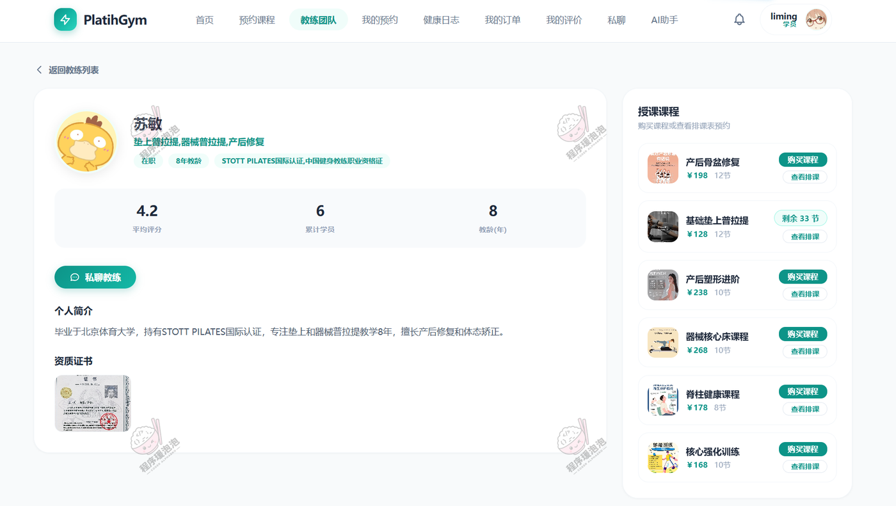

**教练详情**：苏敏，8 年教龄，持 STOTT PILATES 国际认证与中国健身教练职业资格证。三个数据位是平均评分 4.2、累计学员 6、教龄 8 年，下方有个人简介与资质证书原件照片，顶部「私聊教练」直接进对话。右侧是她的授课课程，每门课标注节数，已购的显示剩余课时并可「查看排课」。

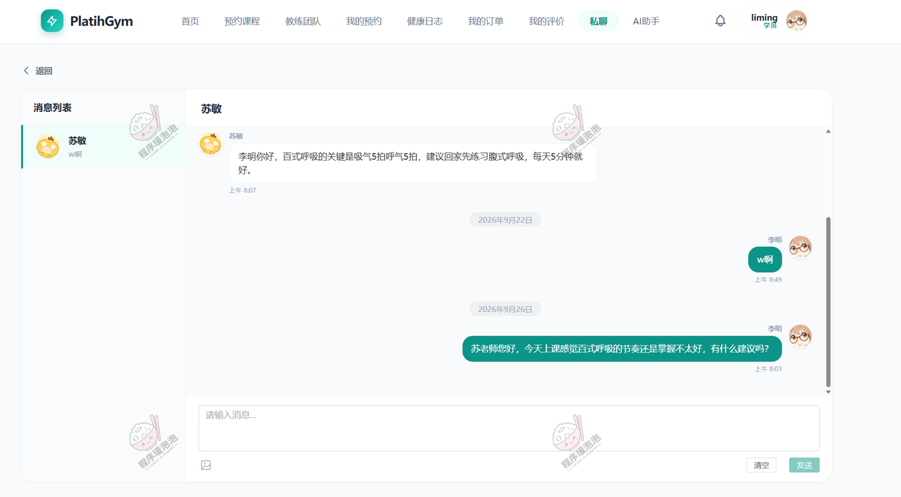

**私聊教练**：左侧会话列表标出教练和最后一条消息，右侧按日期分隔展示历史消息。截图里就是一段真实的课后答疑——学员问百式呼吸的节奏掌握不好，教练回「吸气 5 拍呼气 5 拍，建议回家先练习腹式呼吸，每天 5 分钟就好」。输入框支持回车发送，也能清空重来。

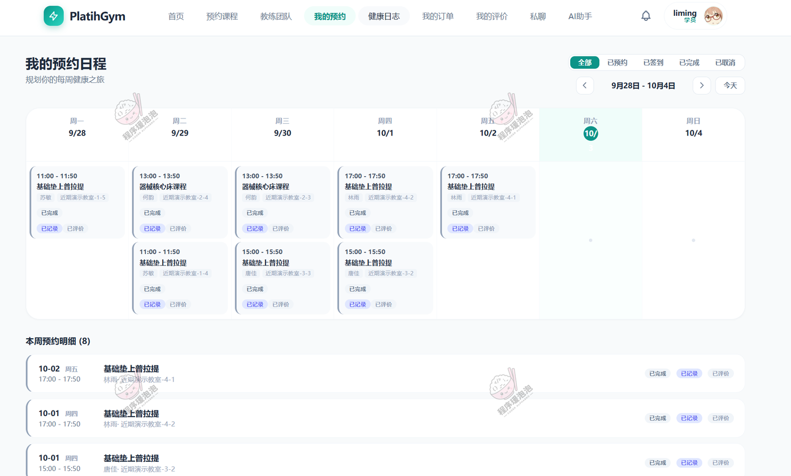

**我的预约**：周视图排布，一格一节课，写明时段、课程、教练、教室和状态，卡片底下「已记录 / 已评价」提示这节课的健康数据和评价有没有补。顶部可按全部 / 已预约 / 已签到 / 已完成 / 已取消筛选，下方还有一份按日期倒序的本周预约明细。

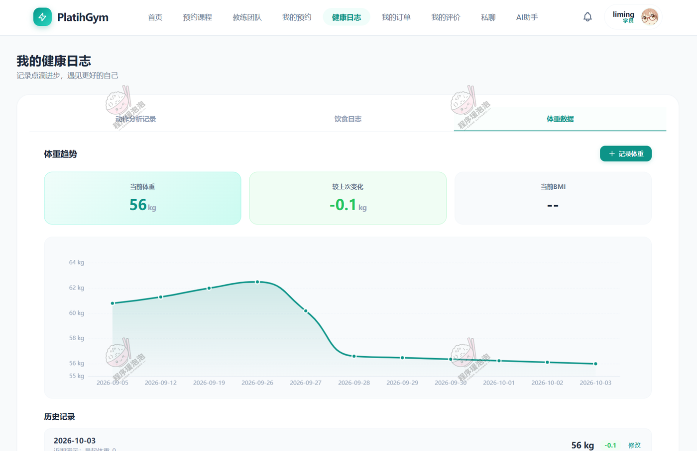

**健康日志**：动作分析记录、饮食日志、体重数据三个标签，体重页给出当前体重 56 kg、较上次变化 −0.1 kg、当前 BMI，配 9 月 5 日到 10 月 3 日的体重折线；每条历史记录可修改，右上角「+ 记录体重」手动补录。

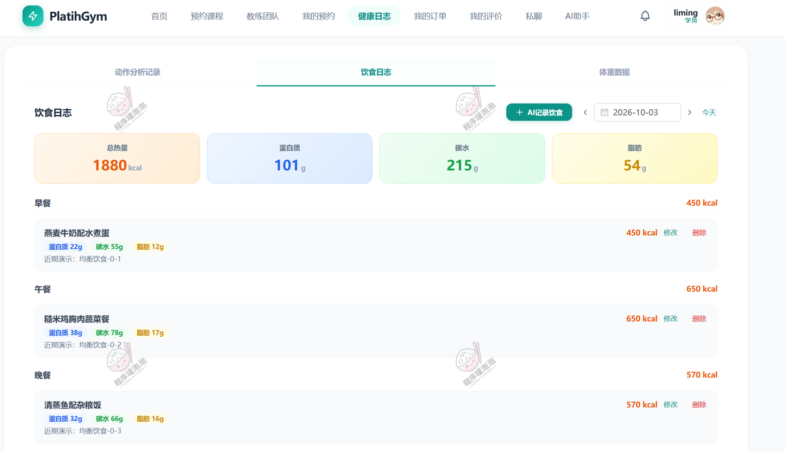

**饮食日志**：四张汇总卡给出当日总热量 1880 kcal、蛋白质 101 g、碳水 215 g、脂肪 54 g，下面按早餐、午餐、晚餐分组，每餐标出热量和三项营养素（如午餐糙米鸡胸肉蔬菜餐 650 kcal、蛋白质 38 g）。右上角「+ AI 记录饮食」就是智能分析入口——描述一顿饭，系统替你拆成这几项。

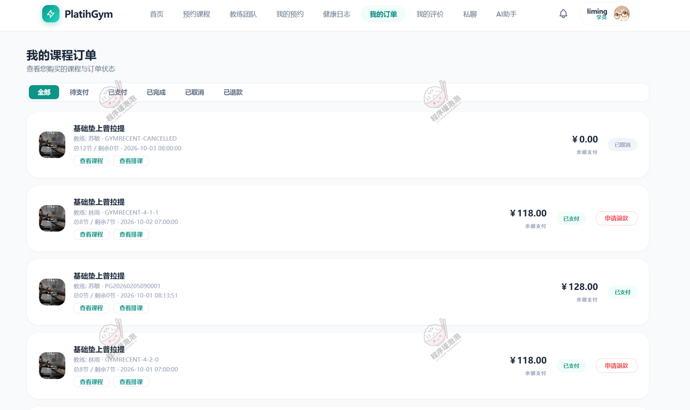

**我的课程订单**：六个状态标签，每张订单写明教练、订单编号、**总节数与剩余节数**（8 节 / 剩余 7 节、12 节 / 剩余 0 节）、下单时间和金额，付款方式统一显示「余额支付」，已支付的可以申请退款。

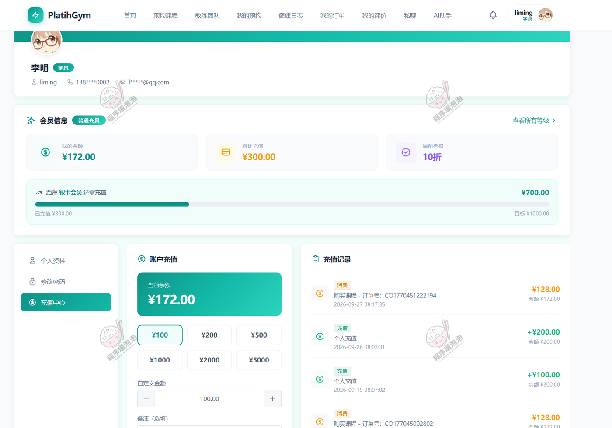

**个人中心与充值**：会员信息区显示当前等级（普通会员）、我的余额 ¥172.00、累计充值 ¥300.00、当前折扣 10 折，进度条给出「距离银卡会员还需充值 ¥700.00」（已充 300 / 目标 1000）。下方充值和流水同屏——消费 −¥128.00 对应购买课程订单号，两笔个人充值 +¥200.00 / +¥100.00，每条都带变动后余额。

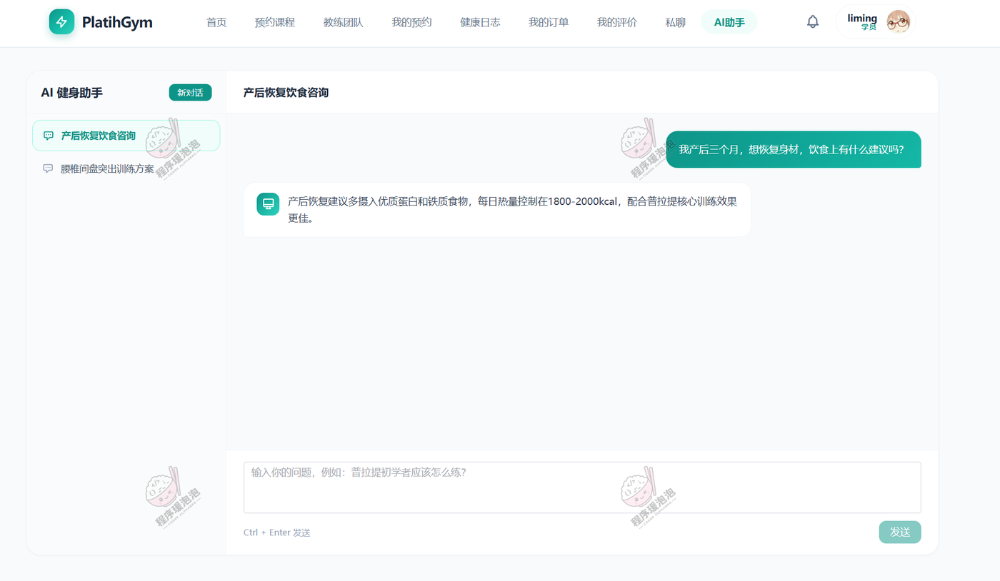

**AI 健身助手**：左侧会话列表按主题分开（产后恢复饮食咨询、腰椎间盘突出训练方案），右侧对话区就具体问题给具体建议——问产后三个月怎么吃，回答里带「每日热量控制在 1800-2000 kcal」这样的量化口径，而不是泛泛而谈。

### 4.2 教练后台

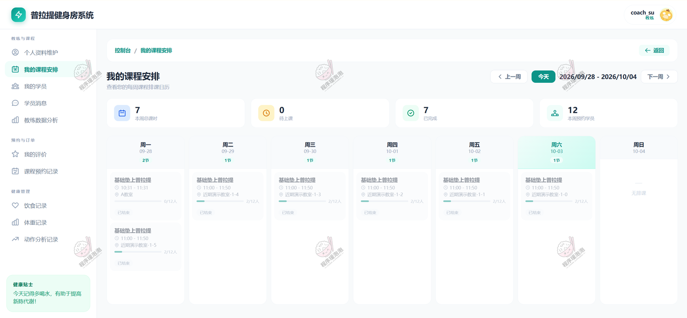

**我的课程安排**：顶部四张指标卡（本周总课时 7、待上课 0、已完成 7、本周预约学员 12），下面是周视图，每节课标出时间、课程名、教室和**已约 / 容量**（0/12 人、2/12 人），上完的标「已结束」。

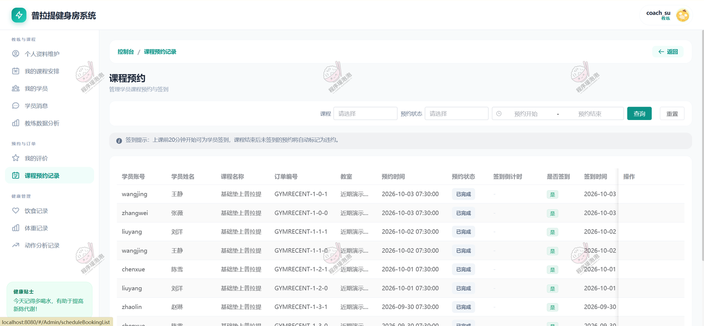

**课程预约记录**：顶部一条签到规则说明——「上课前 20 分钟开始可学员签到，课程结束后未签到的预约将自动标记为违约」。表格列出学员、课程、订单编号、教室、预约时间、状态、签到倒计时、是否签到与签到时间，签到率这类指标就是从这张表算出来的。

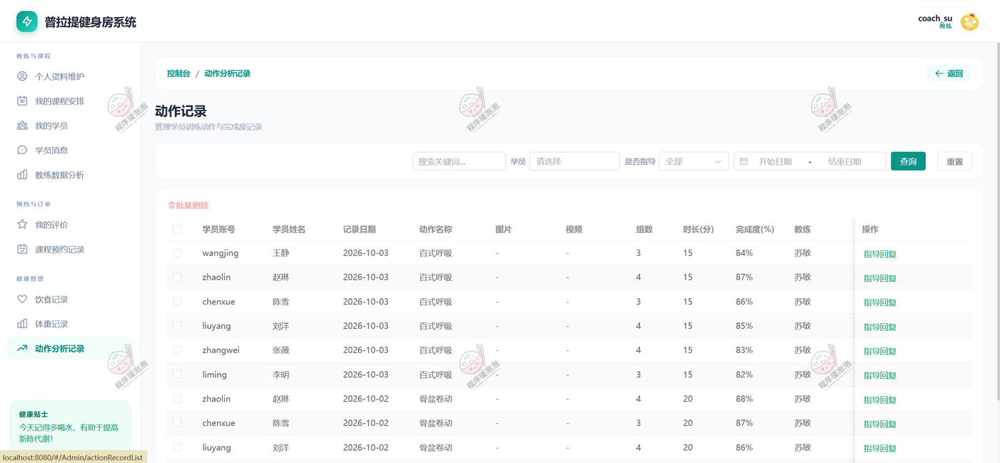

**动作分析记录**：按学员汇总训练数据，一行一个动作，写明组数、时长（分）、完成度百分比和记录的教练（百式呼吸 3 组 15 分 84%、骨盆卷动 4 组 20 分 88%）。每行右侧「指导回复」是教练对这条记录给反馈的入口，学员端记、教练端回，两边的数据是同一套。

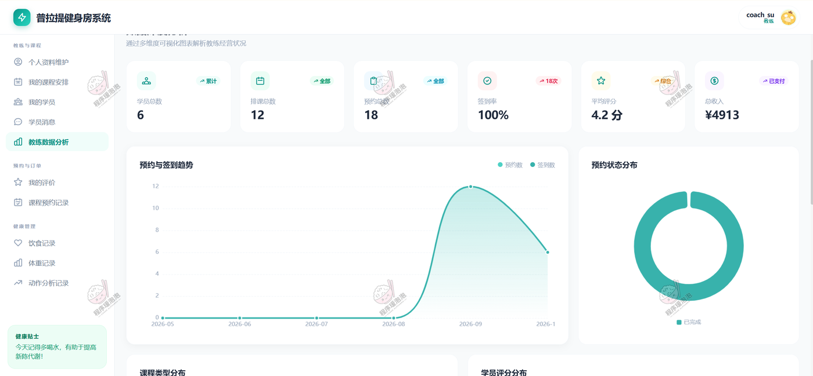

**教练数据分析**：六张指标卡——学员总数 6、排课总数 12、预约数 18、签到率 100%、平均评分 4.2 分、总收入 ¥4913，配预约与签到趋势双折线（9 月是峰值）和预约状态分布环图，再往下还有课程类型分布与学员评分分布。

### 4.3 管理后台

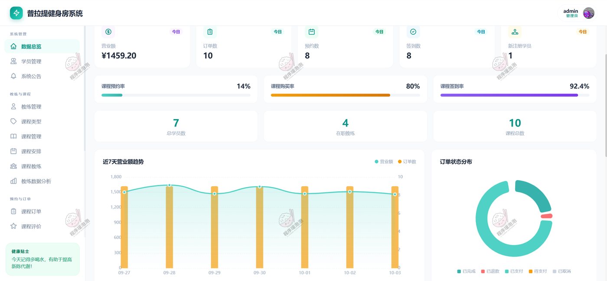

**数据总览**：五张今日指标卡（营业额 ¥1459.20、订单 10、预约 8、签约 8、新注册学员 1），三条完成率进度条（课程预约率 14%、购买率 80%、签到率 92.4%），三个总量（学员 7、在职教练 4、课程 10），下方是近 7 天营业额与订单数双轴趋势，以及订单状态分布环图。

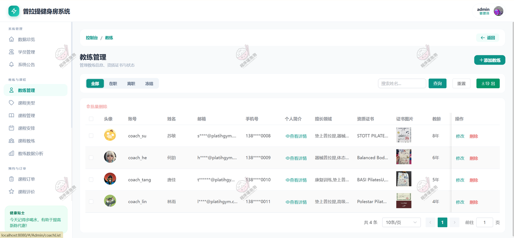

**教练管理**：四位教练的账号、邮箱、手机、擅长领域、资质证书与证书图片、教龄并排列出（苏敏 8 年 STOTT PILATES、何韵 6 年 Balanced Body、唐佳 5 年 BASI Pilates、林雨 4 年 Polestar Pilates），顶部可按在职 / 离职 / 冻结筛选。

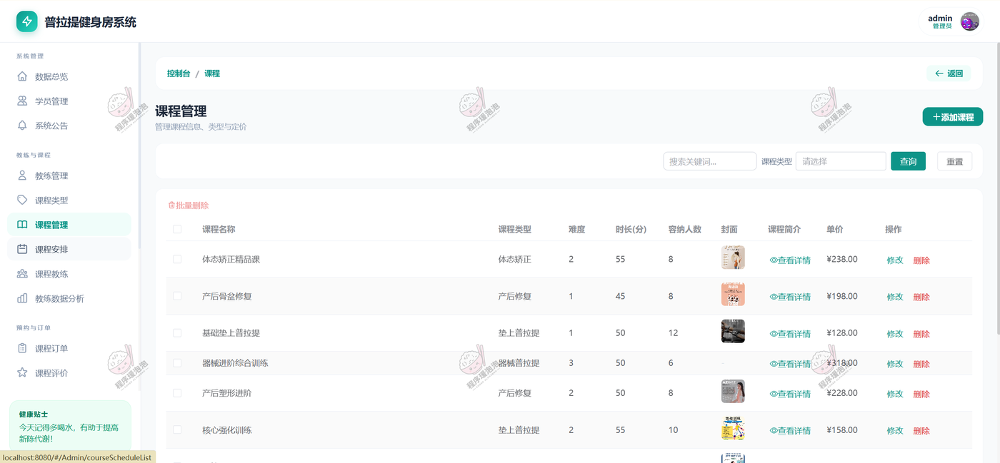

**课程管理**：六门课的类型、难度星级、时长、容纳人数、封面、单价集中维护（从 ¥128 的基础垫上普拉提到 ¥318 的器械进阶综合训练）。这些数字和学员端课程详情页上显示的是同一份，课程类型、难度、时长、价格在各端保持一致。

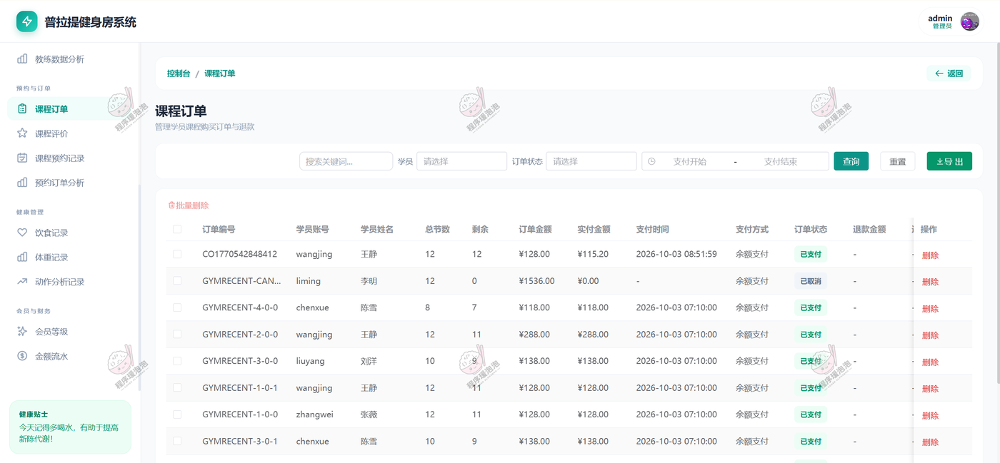

**课程订单**：每单列出总节数、剩余、订单金额、实付金额、支付方式与状态。这里能看到课时和金额的对应关系，也能看到会员折扣的实际效果——有一单订单金额 ¥128.00、实付 ¥115.20，正好是 9 折；还有一单 12 节共 ¥1536.00 因取消而未产生实付。

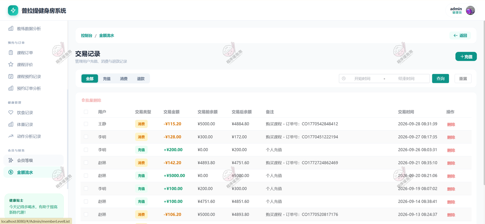

**资金流水**：分全部 / 充值 / 消费 / 退款四类，表格把**交易前余额和交易后余额**并排放，备注里写明是个人充值还是购买课程（附订单号），每一笔都能顺着余额链对上——5000.00 扣 115.20 剩 4884.80，300.00 扣 128.00 剩 172.00，充值则反向增加。

---

文档展示 19 张截图，需要了解更多，请联系我。
